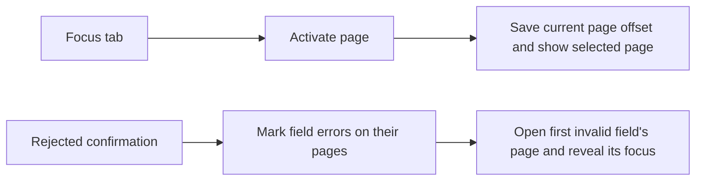

# V01 最小編輯表單（S1）

> **Review-fix status (2026-11-05):** Applications and the V01 acceptance driver use typed handles and data connections; native input and geometry checks use the internal host interface. See [rework verification](evidence/rework-verification.md) for the results and limits. The original [verification](evidence/verification.md) records the earlier S1 revision.

[S1 實作票 #15](https://github.com/Himegragi/LcarsUI/issues/15) 的交付：以正式的 C01 標籤、C02 按鈕、C03 單行文字欄位組成最小 V01 編輯表單，分別以 Minimal Web 與 Material-inspired 外觀啟動。兩套外觀共用同一份表單邏輯、編輯狀態及驗收案例；差異只在呈現與部件安排。資料只在記憶體。

這不是穩定公開 API。型別與回呼形式仍可能隨 S2–S5 調整。

## S3: tabs and page scopes (#21)

The desktop example starts with three fixed tabs. Left and Right move the tab candidate; Enter or Space activates it, and a pointer click activates the clicked enabled tab. The selected tab and keyboard candidate are independently indicated. Disabled pages cannot be activated. An exclamation mark on a tab indicates that a member has a validation error. The framework switches to and reveals the first invalid field in a rejected cross-page confirmation group; errors on other pages remain marked on their tabs.

V01 retains its existing form. V02 uses the same list page and application model as the standalone example: choose a sample, filter by name, reverse the order, disable T008, or delete the selected item. V03 has the progress display, dialog, and tooltip described below. Each page has its own reset; switching retains drafts, history, list selection and the valid page and list scroll offsets. Resetting V02 or V03 leaves V01 untouched.

Applications create tabs with `Ui::add_tabs` and typed `ComponentHandle` members, and use `TabsHandle` for activation and queries. Page membership determines operation admission and rendering. `TabsHandle::add_member` attaches an existing component of any supported type to a page; foreign and already attached handles are rejected. `layout::pinned` keeps the tabs visible above the page's scroll region. Page identity uses `OptionValue`; the application saves per-page scroll state through the page-change callback. A hidden component returns `Status::hidden` for normal operations. A current page cannot be disabled; a page change attempted recursively from its callback is rejected as busy.

## S4: progress (#22)

V03 starts at 50%. Its 0, 50, 100, -10 and 110 buttons change the application-owned source immediately. The progress bar and percentage clamp the displayed value to 0–100, while the source label keeps the original number visible. Reaching 100% does not imply that a background task succeeded. Reset page restores 50% and its scroll position; other pages are retained.

Applications create a non-focusable `ProgressHandle` with `Ui::add_progress` and connect a read-only `NumericSource`. The source must outlive the connection and deliver change notifications on the UI thread. The handle's semantic value and numeric value report the clamped percentage; the application can read its own source separately. There is no progress write connection, and destroying the UI disconnects the subscription.

## S4: tooltip (#24)

The V03 **50%** button has explanatory text. Hover over it or give it keyboard focus and wait 500 ms; the tooltip does not take focus or intercept pointer input. Escape hides it for the current visit, and leaving and returning starts a fresh delay. Opening the dialog, hiding or disabling the source, or deactivating the window closes it. Reactivating the window recalculates eligibility and starts a new delay. The tooltip follows the source's selected appearance, wraps and stays inside the window; the source exposes its text as a semantic description.

Applications attach a tooltip using `Ui::add_tooltip(source_handle, text, delay_ms)`. The source is a non-owning typed handle; the returned `TooltipHandle::visible()` reports whether the tooltip is shown. The delay defaults to 500 ms and can be shortened in tests. Removing the source invalidates the tooltip handle and cancels its pending display. In V03 the existing button still updates the application-owned progress model only when activated.

## S4: modal dialog (#23)

V03's **Reset progress...** opens a window-modal confirmation. Initial focus is Cancel; Tab and Shift+Tab stay inside the dialog, Escape cancels, and the mask blocks background input without closing it. Confirm sets the application-owned progress to 0% and increases the confirmation count once; cancel preserves progress. The displayed result and count are reset with V03. The test seam removes the temporary opener while the dialog is open; closing then returns focus to the permanent dialog opener. The host verification seam also opens the dialog during V01 composition.

Applications assemble dialog content from typed handles, register its initial and fallback focus targets with `Ui::add_dialog`, and open or settle it through `DialogHandle`. `layout::modal` places the content above the window and its mask; it uses the same selected appearance as the opener in this example. `ButtonHandle::remove` accepts owner configuration and commits removal after the outermost UI operation. Pending and removed targets reject operations; their non-owning handles remain invalid even if an ID is reused. This slice provides one dialog at a time; it does not implement nested dialogs or runtime appearance overrides.

## S2c: region and popup layer

Region starts at North, with Central and South available. Enter or a click opens the non-editable dropdown; arrows move a candidate without changing the draft. Enter or clicking an option selects the draft, while Escape, Tab and an outside click cancel the candidate. Tab continues to the next component and an outside click still acts on its target. Apply submits the region with the other four drafts. The region fixture clears or restores the options; clearing removes the selection, and restoring requires an explicit new selection. A missing region is reported on the region field, after name in validation focus order. Reset restores North.

Applications create a `DropdownHandle` with stable `OptionValue` identities, connect an `OptionSource`, and choose immediate, confirmed, or group-confirmed writing. `set_options` rejects duplicate or empty identities, clears a draft or candidate whose identity is no longer enabled, and does not revive it when options return. A popup belongs to its source and uses its appearance. The window-level overlay is drawn and hit above normal content and scrollbars; it anchors below the source when possible, otherwise above, and clamps to the window. `layout::stack` places children at one origin with later children above earlier ones.

## S2b: volume slider

Volume starts at 40 with range 0-100 and step 5. Drag the track, use arrow keys to move to the next value, or use Home/End for the endpoints. The current value is shown beside the slider. The value is a draft until Apply submits it with the name, notices and mode in one confirmation group; Reset restores 40. When an external source update conflicts with a draft, the slider displays the conflict and its **Use latest volume** action restores the source value.

`SliderHandle` connects an application-owned `NumericSource` to an explicitly immediate, confirmed, or group-confirmed numeric write. The integer slider accepts a minimum below its maximum and a positive step. Programmatic values outside the range return `invalid_value`; in-range values are snapped to the nearest minimum-plus-step value or the maximum, whichever is closest; ties go upward. Thus a non-divisible final interval remains reachable and arrows move between adjacent valid values. Source values must already be valid: an invalid initial source rejects connection, and an invalid notification keeps the last valid source value and shows an error. Source lifetime and UI-thread notification requirements match the other connections.

## S2a: checkbox and radio group

The form now includes **Notices** (initially checked) and **Mode** (initially Normal, with Focus and Offline options). Space or a click toggles Notices. Click an option or use the arrow keys to select a mode; navigation skips disabled choices and stops at the ends. The Offline fixture toggles whether Offline can be selected. Reset restores both initial values and re-enables Offline. The current draft and last applied result include all three fields. Apply passes the text, boolean, and option drafts together to one application callback.

Application code creates these fields through `CheckboxHandle` and `RadioGroupHandle`, connects typed sources, and explicitly chooses immediate, confirmed, or group-confirmed writing. Option identities use `OptionValue`; a source of another type requires an explicit adapter. The fields expose draft and semantic state through their handles. The confirmation callback receives typed changes and can return errors associated with individual handles. Source notifications must be delivered on the UI thread and the source must outlive the connection, as for text fields.

The S1-specific descriptions below are historical where they list only the original text field and focus order. The S2a verification and remaining limits are recorded in [rework verification](evidence/rework-verification.md).

## 建置與啟動

需要 Visual Studio C++ Build Tools／Windows SDK、clang-cl、CMake 與 Ninja；沿用 repo 內附的 HarfBuzz／FreeType 原始碼，不下載、不使用套件管理器。在 repo 根目錄的 PowerShell 執行：

~~~powershell
.\build.ps1 -Configuration Release          # 建置並執行全部 CTest（含真實視窗的原生驗證）
.\build\Release\lcars_edit_form_web.exe       # Minimal Web
.\build\Release\lcars_edit_form_material.exe  # Material-inspired
.\build.ps1 -Configuration Release -CoreOnly  # 只建核心：不建立視窗、不連結 OpenGL／字型
~~~

兩個執行檔來自同一份 `main.cpp`，只在組裝時連結不同的外觀函式庫。需要 OpenGL 3.3 core 驅動，以及 Windows 內建的 Segoe UI 與微軟正黑體。

## 畫面與操作

- **名稱欄**：初值「測試使用者」。改名稱只改草稿（「目前編輯值」），不動「上次套用結果」與「套用次數」。
- **套用**：名稱有效才更新結果並恰好加一次計數。名稱空白或全空白（含全形空白）時，在離焦或套用時顯示「請填寫顯示名稱」，無效套用會聚焦名稱且保留舊結果；修正後錯誤即清除。名稱欄裡按 Enter、IME 確認都不會套用。
- **測試入口**（資料區停用時仍可用）：正常、名稱唯讀、資料區停用、名稱錯誤、長說明、重設。「重設」恢復初值、清除名稱欄歷史與顯示偏移、頁面捲回頂端，焦點留在重設按鈕。
- **鍵盤**：Tab／Shift+Tab 依序到達測試入口、名稱、套用並循環，略過停用元件；按鈕上 Enter 按下即啟動、Space 放開才啟動，長按不連發。名稱欄支援 ←／→、Home／End、Shift 選取、Ctrl+A、Backspace／Delete、Ctrl+C／X／V、Ctrl+Z、Ctrl+Y／Ctrl+Shift+Z（只作用於名稱欄本身）。
- **指標**：按鈕要在按鈕內按下並放開才啟動；按下後移出再放開即取消。名稱欄可點擊定位、拖曳選取、Shift+點擊延伸選取。

## 本切片的政策與界線

| 項目 | 決定 |
| --- | --- |
| 貼上換行 | CRLF 算一個換行，單獨 CR／LF 各算一個，每個換行轉成一個空白；其他控制字元（如 Tab）使整次貼上被拒絕，原文字與歷史不變。 |
| 歷史粒度 | 一般輸入／刪除每次一筆；一次貼上（含選取取代）、一次剪下、一次 IME 確認各一筆；新編輯清除該欄位的 redo。 |
| 文字長度上限 | 保留為**公開**的每欄位設定 `Control::max_length`，預設 `lcars::default_max_text_length = 4096` UTF-16 單位。數值沿用 MVP，但現在寫在公開標頭、可由使用端改；超限的整筆編輯被拒絕，不破壞舊文字及歷史。理由：單行欄位需要有界的輸入，S1 不打算為此另訂數值研究。 |
| E01 單欄位失焦 | **離焦即提交組字**。依真實微軟注音事件確定：點別的元件或同一欄位，宿主先請 IME 完成組字（`CPS_COMPLETE`），IME 同步送回結果；視窗失去前景時注音自行提交。組字中按 Tab 由 IME 處理（焦點不動、組字保留）；Esc 取消。欄位 Handle 的 `focus()` 在組字中也採同一政策。原型的「離焦取消」不採用。 |
| E01 close | On WM_CLOSE the host asks the IME to complete preedit using the same policy as focus loss. If the IME does not deliver a result synchronously, the remaining preedit is cancelled. |
| 文字支援邊界（T01） | 單行、由左至右。游標與刪除以 Unicode 碼位為單位，不切開 UTF-16 代理對；繪製與命中以 HarfBuzz cluster 為停駐點。字型：Segoe UI 為主，缺字時改用微軟正黑體（逐碼位選字型），兩者都沒有的字形畫成缺字記號。不支援完整 grapheme cluster、RTL、彩色 emoji、多行。 |
| 版面（B01–B03） | 提供本展示頁需要的直排／橫排、依最小欄寬自動決定欄數的格線與巢狀捲動區。清單有固定高度視口；鍵盤目標逐層揭露，滾輪在內層到達邊界時可交給外層。窄窗（640 DIP）時結果區移到表單下方。 |

## 驗證

The V01 behavior cases drive the assembled form through public handles; native keyboard, pointer, focus traversal and geometry checks use the host/test interface. The independent consumer also checks that string-ID layout and operations are unavailable.

| 入口 | 內容 |
| --- | --- |
| CTest `components`、`layout`、`edit_form` | 核心公開操作、版面與表單驗收；不建立視窗、不需要字型或 GPU。表單案例以「兩套外觀 × 兩組不同邏輯識別」各跑一次。 |
| Clipboard stress | `lcars_host_verify --clipboard-only --repeat 100 --evidence DIR` repeats the native copy/paste case and a short forced-contention case for both appearances. |
| CTest `consumer_example` | 以獨立 CMake 專案（[examples/consumer](../consumer)）只透過公開 target 與 `include/` 組出另一張表單並執行。 |
| CTest `host_native` | `lcars_host_verify --evidence DIR`：真實 Win32 視窗，鍵盤與滑鼠訊息經宿主自己的 `TranslateMessage`／`DispatchMessage` 派送；兩套外觀；960×720／640×480 DIP × 100%／150% 離屏排版與截圖。不會搶前景。 |
| 手動執行 | `lcars_host_verify --ime --evidence DIR`：以 `SendInput` 驅動**真實微軟注音**與真實鍵盤，約 3 分鐘內會接管鍵盤與滑鼠；只要前景視窗不是測試視窗就立即停止送鍵。需要已安裝繁體中文（注音）輸入法。 |
| 真實 DPI | `lcars_host_verify --dpi --evidence DIR`：使用前兩個依水平位置排序的螢幕，移動前景視窗並觀察實際 `WM_DPICHANGED`、選取、實體點擊、組字、游標查詢、候選窗定位請求及下拉彈出層。需要不同縮放的螢幕及微軟注音；這會移動視窗並短暫操作鍵盤與指標。候選窗的實際畫面位置仍需目視驗證。 |

驗收紀錄、工具鏈與代表畫面見 [evidence/rework-verification.md](evidence/rework-verification.md)。
