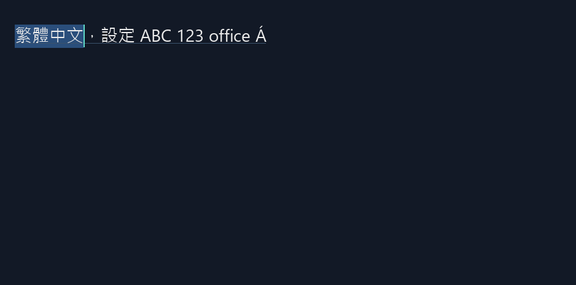

# HarfBuzz＋FreeType 文字管線原型（可丟棄）

目的：先驗證固定原始碼建置、繁中 shaping／fallback、字形點陣化及 OpenGL 顯示是否接得起來。
這是文字整合議題的第一個實測階段；**尚未完成自繪編輯器的 IME／UIA 整合**。

## 執行

```powershell
powershell.exe -NoProfile -ExecutionPolicy Bypass -File prototypes/text-pipeline/run.ps1 -Interactive
```

從 worktree 根目錄執行；無 package manager。原始碼壓縮檔隨附在 third_party，CMake 校驗後在 build/sources 展開並建置，沒有 configure-time 網路下載。
預期本機已有 clang-cl、Visual Studio C++ Build Tools、CMake、Ninja，以及 Windows tar。
測試字型使用本機 `C:/Windows/Fonts/segoeui.ttf`、`msjh.ttc`、`mingliu.ttc`；不隨原型散布字型。

上方是 Windows 原生輸入框，可輸入、選取文字；下方是 HarfBuzz＋FreeType＋OpenGL 的單行預覽。
- 「切換繁中字型」在微軟正黑體與細明體的測試檔之間切換。
- 「字級 ±」調整預覽的實際像素字級；不是完整產品的 DIP／系統文字縮放設定。
- 下方點擊會以 HarfBuzz 產生的位置查找 UTF-16 cluster 邊界，再更新上方輸入框選取。
- 關閉主視窗結束。不加 Interactive 會完成自動檢查、輸出影像並退出。

## 目前管線

`UTF-16 文字 → 簡化 script/font runs → HarfBuzz zh-TW LTR shaping → glyph/cluster/advance → FreeType 點陣化 → CPU RGBA 圖 → OpenGL texture`

原型以 Segoe UI 作為 Latin 主字型，繁中缺字改用正黑體或細明體；輸出 glyph-map.tsv 記錄實際 family、glyph ID、UTF-16 cluster、位置與 advance。
選取與預覽游標使用同一份 layout 座標。這不是每個字形獨立 GPU atlas；整條文字先合成 CPU 圖再上傳，尚未做快取／效能架構。

## 2026-10-08 實測結果

Windows11 build26200、clang-cl22.1.8、CMake4.3.1-msvc1、NVIDIA RTX3060／610.62、OpenGL3.3 core。

| 驗證 | 結果 |
| --- | --- |
| 固定版本來源建置 | HarfBuzz14.6.0＋FreeType2.14.1，CMake/Release，通過 |
| 繁中與英文混排 | `繁體中文，設定 ABC 123`：有 fallback，沒有缺字 glyph |
| 字型切換 | 兩個繁中字型皆可 shape 測試字串，無缺字 |
| 字級變更 | 28→42px 重新量測，寬度增加；20/28/42px 三張渲染輸出 |
| 重音組合字 | `office A + U+0301` 可 shape，未在重音碼位額外產生 caret stop |
| UTF-16 surrogate pair | 補充平面測試沒有在 pair 中間產生 caret stop；不保證該字一定有字型覆蓋 |
| 位置查詢 | 混排 fixture 的 cluster 位置→hit test 往返一致 |
| 缺字 | U+10FFFF 明確產生 missing-glyph 記錄，不當成成功覆蓋 |
| OpenGL 傳輸／繪製 | RGB readback 與 CPU image 逐像素誤差不超過1；成功釋放資源 |
| 原生輸入載體 | EM_REPLACESEL 選取替換與 EM_UNDO 回復 fixture 通過；不等同自繪編輯實作 |

影像 `evidence/text-28.bmp` 為 GPU framebuffer 讀回，只包含預覽區域，不含上方原生輸入框。



## 相容性修正與依賴限制

HarfBuzz 固定版本中的 `context_depend_sets_are_cached` 是標頭內 static helper，在某個 clang-cl translation unit 未使用；上游 pragma 將此警告視為錯誤。
本原型 CMake 將**這一個函式**由 `static bool` 改為 `static inline bool`。未關閉 warning-as-error 或其他驗證；原始 archive 及其雜湊不變，修改只作用於展開的建置副本。
首次失敗與修正後建置日誌均保留。這項相容性修正仍需正式選版時重新評估。

FreeType 關閉可選 Zlib/BZip2/PNG/Brotli 及反向 HarfBuzz auto-hinting 依賴，HarfBuzz 單向連結 FreeType。
沒有啟用 HarfBuzz experimental raster/vector/GPU、subset、命令列工具；不因此聲稱涵蓋彩色字型、WOFF、所有點陣格式。
上游 non-build CLAUDE.md symlink 因 Windows tar 限制略過；其餘原始壓縮檔內容與授權保持。

## 尚未驗證與下一步

1. 原生 Edit 有自己的排版與平台整合；下方自繪預覽並未成為 IME/TSF 或 UIA 的文字提供者。不能將原生欄位的能力算成自繪引擎已完成。
2. 尚未測實際 IME 組字／取消／候選窗定位、跨 DPI、UIA TextRange／Narrator、自繪 clipboard／undo。
3. runs 只服務 LTR 繁中＋Latin fixture；簡化 fallback 不是完整 grapheme-aware fallback。尚未決定 Unicode segmentation／bidi／換行依賴。
4. caret 只暴露 HarfBuzz cluster 邊界；尚未處理連字內合法游標位置、全部 grapheme 規則、RTL 或多行。內部使用 UTF-16 是此 Windows probe 的表示選擇，不是正式 Core 編碼決策。
5. `zh-TW` 與臺灣字型檔選擇已明確設定，但代表性地區異體字尚未作 golden-image 人工比較。
6. 目前只選兩套本機測試字型，不代表已完成任意字型 picker、產品預設字型或隨附字型決策。
7. UI 更新時才重繪；CPU合成、同步像素讀回是驗證用，未測效能或字形快取。

下一階段需將文字 layout／編輯狀態／Windows IME與UIA的共同位置契約做成獨立原型，再決定正式文字介面。
