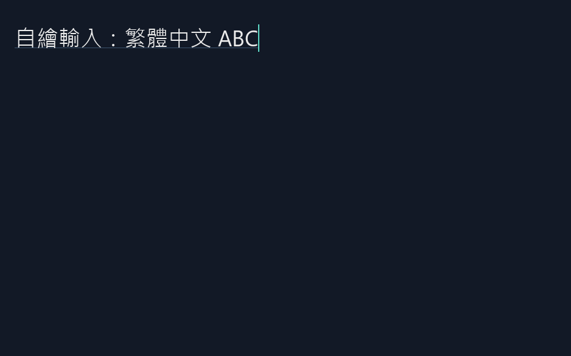

# 自繪編輯、IMM 與 UIA Value 原型

2026-10-08，Windows 11 本機測試。這是可丟棄的整合探針，不是完整文字編輯器或合規 UIA Edit 實作。
本輪沒有實作 Linux/macOS 平台轉接，也沒有新增渲染診斷系統。
後續已增加有限的 TextRange 原型與跨程序驗證，最新範圍、限制及尚未定位的偶發問題見 [TextRange 測試紀錄](TEXT_RANGE.md)。下列 Value-only 能力描述保留為較早階段紀錄。

## 執行

```powershell
powershell.exe -NoProfile -ExecutionPolicy Bypass -File prototypes/text-pipeline/run.ps1 -SelfDraw -Interactive
```

不加 Interactive 會執行自動情境並結束。沿用 CMake、固定原始碼、clang-cl 與 OpenGL；不新增套件管理器或第三方依賴。
此視窗沒有原生 Edit 子視窗。文字與選取由共用 editing::Model 持有，再由 HarfBuzz／FreeType／OpenGL 繪製。

操作：點擊設定游標；Shift+點擊／方向鍵選取；Home/End、Backspace/Delete；Ctrl+A/Z/Y；手動 Ctrl+C/X/V（單行文字，貼上有換行或 Tab 時拒絕）。
F2 切換繁中字型；F3/F4 改 DIP 字級；組字中 Esc 取消，非組字中 Esc 關閉視窗。
剪貼簿分支供人工操作，本輪自動情境沒有讀寫使用者剪貼簿，不能將該分支標記為已驗證。

## 狀態與平台分工

- `editing_model.hpp`：純 C++ UTF-16 文字、anchor/caret、preedit、提交／取消、undo/redo 交易；不引用 Win32、GL、FreeType 或 UIA。
- `selfdraw_editor.cpp`：Win32 事件轉接，IMM composition 資料讀取，候選窗位置、IME 字元位置查詢，以及 UIA Value provider。
- 文字位置仍來自前一輪的簡化 LTR cluster layout；尚不是完整 grapheme／連字內游標規則。
- UIA provider 從有鎖的快照讀值；SetValue 同步送回 UI 執行緒，避免 COM worker 直接修改文字或呼叫 FT/GL。
- OS 輸入法與 UIA 是平台轉接；共用模型不依賴這兩個 Windows API。但只有 Windows 完成實測。

## 已通過的自動情境

| 情境 | 實際證據 |
| --- | --- |
| 組字更新 | preedit 只改 presentation，不污染 committed text |
| 取消組字 | 恢復原文字與組字前選取 |
| 提交組字 | 替換選取一次，多次 preedit 更新只形成一筆 undo |
| undo／redo | 可撤銷／恢復已提交文字；組字中的 undo 取消 preedit |
| 自繪輸入 | HWND 無原生 Edit child；WM_CHAR 進入共用模型 |
| surrogate fixture | UTF-16 高低代理碼合併輸入；Backspace 不拆開該 pair |
| 字級與候選窗 | 改字級後重算 caret/candidate；ImmSetCandidateWindow/ImmGetCandidateWindow 往返一致 |
| IME 字元位置查詢 | IMR_QUERYCHARPOSITION 以共用 layout 回傳 screen position，與 caret 幾何一致 |
| 組字中 UIA 寫入 | 返回 UIA_E_INVALIDOPERATION，不覆蓋未完成的組字 |
| 組字中 Esc | 取消組字，不關閉視窗 |
| 真實 UIA client | 另開 MTA thread，以 CUIAutomation.ElementFromHandle 取得角色、Value pattern，SetValue/GetValue 成功 |
| UIA 生命週期 | provider 持有共享快照；關閉時標為不可用並 disconnect；尚未壓測 shutdown 競態 |
| UIA 範圍 | 系統 HWND bounds 相符；**不是文字範圍** |
| 舊原型回歸 | 原 text_probe 的 shaping／字型／GL 情境仍通過 |

自動 log 的真實 WM_IME_COMPOSITION/result 計數均為 0：測到的是組字模型與 adapter 的座標接點，不是人工輸入法端到端成功。
最初測試使用同一 process 的獨立 MTA thread。後續跨 process 測試見下節；Narrator 尚未測。

## 跨程序補測

```powershell
powershell.exe -NoProfile -ExecutionPolicy Bypass -File prototypes/text-pipeline/run.ps1 -CrossProcess
```

此指令建置獨立 `editor_cross_host.exe`，不覆寫已開啟的互動 `editor_probe.exe`。
Host 啟動沒有主視窗的 `uia_external_client.exe`；client 驗證 HWND 所屬 PID、UIA ProcessId 與 AutomationId，確認是另一個已知程序內的測試欄位後才写入。

2026-10-08 本機通過：
- 跨程序取得自繪欄位的 Edit role、Value pattern，寫入／讀回繁中＋英文值。
- 訂閱 Value property changed，收到正確新值的事件（本次 count=1）；解除訂閱成功。
- 多行輸入回傳 E_INVALIDARG（0x80070057），已提交值不變。
- 使用**測試專用訊息**建立模擬組字狀態後，跨程序寫入回傳 UIA_E_INVALIDOPERATION（0x80131509），已提交值不變；取消後狀態恢復。
- 調整專用測試視窗大小後，UIA BoundingRectangle 與 physical HWND bounds 相符。
- 未實作的 TextPattern 明確不對外宣告可用。

`evidence/uia-cross-process.log` 是獨立 client 的紀錄；`evidence/cross-process-build.log` 包含 host 檢查與建置。
測試 hook 僅在 `--cross-process` 模式啟用，不是正式公開介面，也不是實際 IME 輸入。
所有讀寫只针对本輪建立的專用測試視窗，不使用系統剪貼簿；這仍不代表 TextRange、Narrator 或實際輸入法已通過。



## UIA 範圍的修正

實測發現簡單 HWND provider 的 BoundingRectangle 由系統 host 提供，回傳整個視窗。
因此自動檢查將它與 GetWindowRect 比較；沒有把這個結果當作字形矩形／TextRange 已通過。
本 provider 明確只提供 Value pattern，TextPattern available=false；Microsoft 指南要求完整文字控制項提供 Text/TextRange，因此仍不滿足完整無障礙驗收。

## Windows 路線與待驗證項目

本輪接入 **IMM 相容介面**，不是自訂 TSF text store。它處理 WM_IME_STARTCOMPOSITION、GCS_COMPSTR、GCS_RESULTSTR、GCS_CURSORPOS、取消及 IMR_QUERYCHARPOSITION。
尚未驗證所有輸入法、組字屬性／子句／重轉換、焦點切換中完整 IME 行為；原型只以整段 preedit 高亮呈現。

仍需人工：
1. 常用注音／倉頡輸入「設定」，檢查候選窗位置、提交與取消。
2. 提交後 Ctrl+Z 是否一次撤銷；檢查沒有重複提交。
3. 跨螢幕 DPI、字型切換、長文字水平捲動時的候選窗與選取。
4. 正式 Text/TextRange provider、文字範圍矩形、selection事件與 Narrator。跨程序 Value 已通過，不外推成完整無障礙。

Linux/macOS 尚未實作或實測。本機 WSL 的 PATH 中未找到 CMake、clang++、g++；本輪沒有安裝工具或假稱非 Windows 測試通過。

## 官方參考

- [處理 WM_IME_COMPOSITION](https://learn.microsoft.com/en-us/windows/win32/intl/processing-the-wm-ime-composition-message)
- [實作 server-side UIA provider](https://learn.microsoft.com/en-us/windows/win32/winauto/uiauto-serversideprovider)
- [Text/TextRange 指南](https://learn.microsoft.com/en-us/windows/win32/winauto/uiauto-implementingtextandtextrange)

原型的設計與測試結論不代表 Windows 10 或其他 GPU／OS 已通過。
