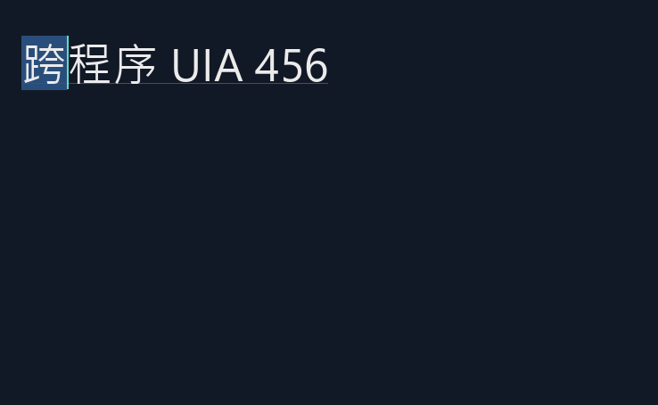

# TextRange 單行原型與跨程序測試

2026-10-08。此輪增加有限的 Text/TextRange provider，不代表完整 UIA Edit 合規或 Narrator 已通過。
使用原本的 `run.ps1 -CrossProcess` 建置與執行；不新增套件依賴。

## 本輪通過的情境

- 外部程序取得 TextPattern、DocumentRange，文字與 Value 一致。
- Clone、Compare、CompareEndpoints、MoveEndpointByRange、Character 範圍移動、Document 擴展。
- 大小寫不敏感搜尋 `UIA`，回傳正確子字串。
- GetSelection／Select 能改變共用編輯模型，並收到 TextSelectionChanged。
- 文字修改後收到 TextChanged；Value property changed 仍維持。
- GetBoundingRectangles 使用渲染的同一份 layout：是文字行的矩形，不再拿 HWND bounds 充當文字範圍。
- RangeFromPoint 的螢幕座標對應第一個游標邊界。
- 字級變更後，舊範圍的文字端點仍有效，矩形寬高重新計算。
- 空文字回傳空內容，退化範圍回傳空矩形陣列。
- 長文字 ScrollIntoView 不修改內容，範圍與 viewport 左緣對齊。
- 外部程序選取第一個漢字後，host 讀回 UIA 提供的螢幕矩形，轉回 OpenGL client 座標，在該矩形內取樣得到反白色 RGB `(42,78,123)`。

## 範圍生命週期提案

範圍綁定文字 revision。只改字型／字級／捲動／視窗位置時沿用文字端點並更新幾何。
文字被修改後，舊範圍回傳 `UIA_E_ELEMENTNOTAVAILABLE`（實測 `0x80040201`）；client 重新取得 DocumentRange。
此策略避免舊 offset 指向新文字，但**不是最終的動態範圍追蹤設計**，需要評估真實輔助工具對範圍存續的要求。

## 執行緒與事件

provider 的文字與幾何由 UI thread 發布到有鎖快照；範圍方法只讀快照，Select／ScrollIntoView 同步回 UI thread。
沒有從 UIA COM callback 呼叫 FreeType 或 GL。所有互動仍在原型單 UI thread 模型下。
UIA client 的 SetValue 已改用真正 `SysAllocStringLen` 配置的 BSTR，取代不正確的一般字串指標。

## 有界線的實作

- 僅單行 LTR，無嵌入子物件、多重選取或 ITextProvider2。
- Character 暫沿用 HarfBuzz cluster 邊界；不能因此宣稱已滿足 Unicode grapheme 與連字內游標規則。
- Word／Format／Paragraph 等未獨立支援，提升到較大的單行／Document 單位；並非真正語言學斷詞。
- 只有部分文字屬性；未知屬性回傳 UIA reserved NotSupported 值。FindAttribute、選取等分支已補邊界測試（見下節），仍非完整。
- preedit 出現在可見文字快照，會使 range revision 改變；實際 IME、重轉換與輔助工具對此行為尚未驗證。
- 相同文字的重新提交等事件語意、provider shutdown 競態、完整失效契約仍需測試。
- 實際候選窗、Narrator、跨螢幕 DPI、Windows10 及其他 OS 尚未通過。

## 邊界與負面契約（後續一輪）

client 在原情境後新增 `range_contract_edges`，再重建最後的選取供 host 渲染比對。
- 過期範圍：Clone、GetAttributeValue（支援／不支援屬性）、FindAttribute（true/false）、FindText、Compare／CompareEndpoints（兩個方向）、MoveEndpointByRange、Expand、Move、MoveEndpointByUnit、矩形、EnclosingElement、Children、Select、AddToSelection、RemoveFromSelection、ScrollIntoView，共21個呼叫，全部要求 `UIA_E_ELEMENTNOTAVAILABLE`。之後 Value 不變，且在同一 revision 下用 Compare／CompareEndpoints 比對選取數量與確切端點不變（實測選取為文件尾端的收合游標，不能只比文字）。
- 已證實並修正兩個缺陷：過期範圍 `FindAttribute(IsReadOnly,true)` 回傳 `S_OK`/null（無法分辨「沒找到」與「範圍過期」）；`RemoveFromSelection` 不檢查存續，一律回 `UIA_E_INVALIDOPERATION`。現在先檢查 revision。
- 有效範圍：IsReadOnly 為 false；不支援屬性為 reserved NotSupported；未支援屬性搜尋不會假造結果（實測 `UIA_E_NOTSUPPORTED`）。
- 退化範圍在文件頭尾的 Move／MoveEndpointByUnit 夾住且回報0；start 越過 end 時 end 跟著移動。
- 單一選取：重複加入同一範圍成功；加入第二個不相交範圍及 RemoveFromSelection 回 `UIA_E_INVALIDOPERATION`。
- 已驗證的 provider 行為：host 直接呼叫 provider（不經 UIA client），endpoint 值7 的 CompareEndpoints（兩側）與 MoveEndpointByUnit 回 `E_INVALIDARG`，輸出為0，範圍端點不變。
- 外部 client 只做觀察、不算 provider 驗證：無效 unit 得到 `E_UNEXPECTED`；endpoint 值7 得到 `S_OK`，結果與 End 相同（CompareEndpoints 回1、MoveEndpointByUnit 移動 End -1）。推論是 UIA client／傳送層在 provider 之前正規化了此值，但未加 instrumentation，不能確定在哪一層發生。

證據：`evidence/textrange-edges-red-*.log`、`textrange-edges-green-client.log`、`textrange-edges-review-client.log`、`textrange-edges-review-direct-provider.log`、`textrange-edges-verification.log`。

## 保留範圍的幾何變更（後續一輪）

client 新增 `geometry_changes`：保留第一個字的範圍，依序做視窗移動、F3／F4 字級、F2 字型兩次、縮短視窗、高度不足文字列、還原大小、長文字水平捲動。
每一步都檢查保留範圍的確切端點、文字、選取與 Value 不變（範圍仍可用，代表 revision 沒變）。

- 已證實並修正：視窗內容區比文字列矮時，矩形底部仍回報 `origin.y+pixels()+10`，超出內容區（實測底部336，內容區底305）。
  現在 `sync` 把文字列裁到內容區底部；內容區在文字列上方結束時高度為0，矩形與 GetVisibleRanges 都是空的。
- 移動視窗：矩形平移量與視窗位移完全相同。F3 縮小、F4 還原；兩次 F2 後還原。
- 水平捲動：捲出畫面的範圍沒有矩形；長範圍左右兩邊都被 viewport 裁掉；GetVisibleRanges 起點等於捲到左緣的字；RangeFromPoint 在左緣命中同一字。
- 結束時還原視窗位置、大小、字級、字型與捲動，最後 GL_BACK 反白取樣仍為 `(42,78,123)`。
- 點擊測試：在初始狀態、移動視窗、F3、F4、F2、第二次 F2 之後，對保留矩形左右緣內1像素做 RangeFromPoint，分別命中範圍的起點與終點。
- 窄寬度：要求客戶區寬73（讓第一個字被右邊界裁一半）與40（內容寬度為0），實際都只能縮到176。
  原因是原生視窗最小拖曳寬度 `SM_CXMINTRACK=198`（外框）。因此改驗證：保留的整份文件範圍右緣剛好被裁在 `client.right-24`（寬128＝176−48），第一個字矩形不變。
  **內容寬度為0與第一個字被右邊界裁切兩種情境，在此視窗上無法達成，沒有通過也沒有假造**；要測需改用子視窗或處理 `WM_GETMINMAXINFO`，本輪未做。

限制：
- 只測同一 DPI（144）下的字級變化，**沒有測跨螢幕 DPI 變更**。
- F2 對測試用的第一個字矩形沒有變化（此字兩種字型寬度相同），只證明切換後矩形與點擊測試一致，不能證明字型切換會改變寬度。
- 高度為0的情境只在修正後執行；紅燈在前一個斷言就停止，所以它修正前的行為未觀察。
- 只檢查文字列的上下裁切，以及捲動造成的左右裁切；沒有測視窗部分在螢幕外，或被其他視窗遮住的情況。
- RangeFromPoint 仍只依 x 座標決定位置，忽略 y。

證據：`evidence/geometry-red-short-viewport.log`、`geometry-green-client.log`、`geometry-verification.log`、`geometry-width-hit-client.log`、`geometry-width-hit-verification.log`。

## 不穩定結果：尚未確定根因

後續已追加20次追蹤、受控故障與例外清理修正，見 [UIA 重跑與清理回歸](UIA_STRESS.md)；原偶發根因仍未定論。
再後續的 [並行與銷毀測試](CONCURRENT_LIFECYCLE.md) 捕捉了可確認的 IME 干擾重現，已將自動測試改為不取焦點；仍不對缺少原始軌跡的歷史個案作絕對歸因。

開發此輪時曾有兩次跨程序失敗：一次 Select 後讀回的選取不符；另一次初次 SetValue 得到 `UIA_E_INVALIDOPERATION`。
後者可能涉及組字狀態或外部訊息交錯，但**沒有足夠證據判定根因**，不宣稱已修復。
加入針對性紀錄後，5 次連續測試通過；移除臨時診斷後，重建的一次測試及另 3 次連續執行通過。這些成功不足以排除先前偶發。
保留診斷／連續執行日誌，未透過跳過功能或放寬斷言使測試通過。後续應在可重現條件下隔離 OS IME 與測試訊息，並檢查選取快照的時序。

## 證據

- `evidence/textrange-build.log`：移除臨時診斷後的建置與完整情境。
- `evidence/textrange-clean-1.log` 至 `-3.log`：後續連跑。
- `evidence/textrange-diagnosis.log`、`textrange-trial-*.log`：帶臨時診斷的觀察。
- `evidence/uia-textrange-client.log`：外部程序詳細步驟。
- `evidence/uia-text-rectangle.tsv`、`textrange-selection.bmp`：跨程序回報的矩形及其反白畫面。

參考：[Microsoft Text/TextRange 指南](https://learn.microsoft.com/en-us/windows/win32/winauto/uiauto-implementingtextandtextrange)。
